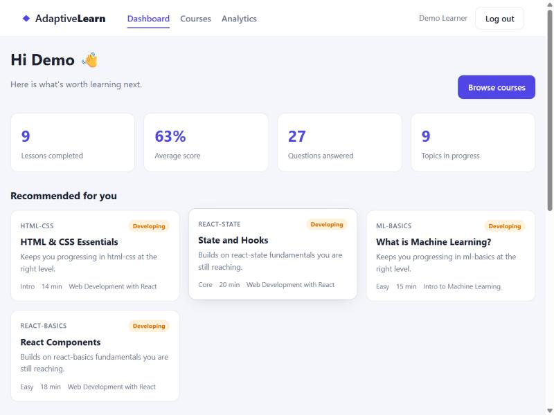
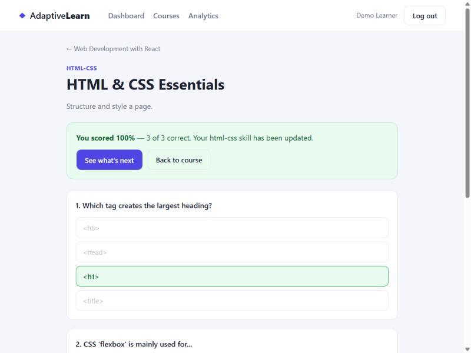

# Adaptive Learning Platform

A full-stack web application that builds a personalised learning path for each
learner. As you work through lessons and answer quizzes, the platform keeps a
running estimate of how well you know each topic and uses it to recommend what
to study next — nudging you toward material that is challenging but not out of
reach.

Built with **React, Node.js, Express, MongoDB, and Python**.



## Features

- **Adaptive recommendations** — an engine estimates per-topic skill from your
  quiz history and ranks the lessons most worth doing next, each with a reason.
- **Difficulty that adapts** — recommendations target the edge of your ability
  (the "zone of proximal development") instead of a fixed order.
- **Real-time learner profiling** — every answered question updates your skill
  estimate for that topic.
- **Progress tracking & analytics** — completion, average score, accuracy, and
  mastery broken down by topic.
- **JWT authentication** — register, log in, and keep a private learning record.
- **Offline cohort analysis** — a Python script segments learners into cohorts
  and surfaces the topics people struggle with most.



## Tech stack

| Layer      | Technology                                   |
| ---------- | -------------------------------------------- |
| Front-end  | React 18, React Router, Vite                 |
| Back-end   | Node.js, Express, JWT, bcrypt                |
| Database   | MongoDB (Mongoose)                           |
| Analytics  | Python (standard library; optional pymongo)  |

## Project structure

```
adaptive-learning-platform/
├── server/        Express API, Mongoose models, adaptive engine, tests
├── client/        React single-page app (Vite)
└── recommender/   Python learner-cohort analytics
```

## How the adaptive engine works

The core logic lives in [`server/src/services/adaptiveEngine.js`](server/src/services/adaptiveEngine.js):

1. Each answered question updates a topic skill estimate (0–1) with an
   Elo/IRT-style update — harder questions move the estimate more.
2. For every candidate lesson, a score blends three signals:
   **relevance** (weaker topics first), **fit** (difficulty close to the
   learner's target level), and **readiness** (are the prerequisites in place?).
3. The highest-scoring lessons the learner hasn't completed become the
   recommendations.

The engine is pure functions, covered by unit tests (`npm test` in `server`).

## Getting started

### Prerequisites
- Node.js 18+
- MongoDB (local or Atlas) — or use the zero-setup in-memory mode below

### 1. Back-end

```bash
cd server
npm install
cp .env.example .env        # set MONGODB_URI and JWT_SECRET
npm run seed                # load courses + demo learners (optional)
npm start                   # http://localhost:4000
```

No MongoDB handy? Run the API against a throwaway in-memory database with demo
data already loaded:

```bash
cd server
npm install
npm run dev:mem             # http://localhost:4000, data lives in memory
```

### 2. Front-end

```bash
cd client
npm install
npm run dev                 # http://localhost:5173
```

Log in with the demo account: **demo@learn.dev / demo1234**

### 3. Analytics (optional)

```bash
cd recommender
python make_sample.py
python analyze.py
```

## API overview

| Method | Endpoint                         | Description                           |
| ------ | -------------------------------- | ------------------------------------- |
| POST   | `/api/auth/register`             | Create an account                     |
| POST   | `/api/auth/login`                | Log in, receive a JWT                 |
| GET    | `/api/auth/me`                   | Current user                          |
| GET    | `/api/courses`                   | Course catalogue                      |
| GET    | `/api/courses/:id`               | Course with its lessons               |
| GET    | `/api/lessons/:id`               | A lesson and its quiz (no answer key) |
| POST   | `/api/lessons/:id/submit`        | Grade a quiz, record progress         |
| GET    | `/api/recommendations`           | Adaptive lesson recommendations       |
| GET    | `/api/profile`                   | Per-topic skill profile               |
| GET    | `/api/progress`                  | Completed lessons                     |
| GET    | `/api/analytics/summary`         | Headline learning stats               |

## Testing

```bash
cd server
npm test        # unit tests for the adaptive engine
npm run smoke    # end-to-end API test on an in-memory MongoDB
```

## License

MIT
